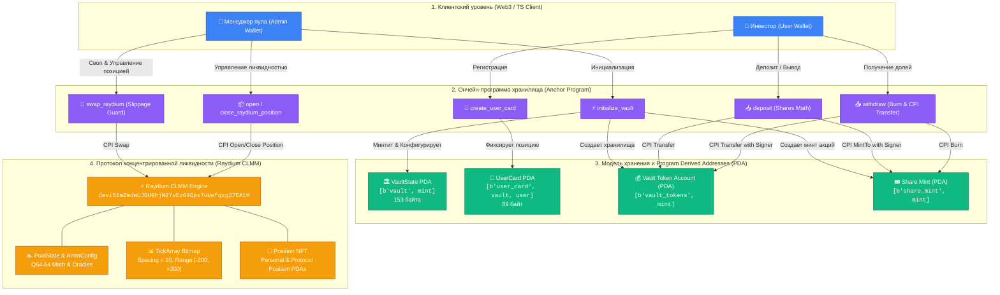

# ⚡ Solana Engineering & Solana CLMM Vault(Weeks 3–13)

<div align="center">


**Автор работы:** Илья Коваленко  
**Специализация:** Solana Blockchain & Web3 Systems Engineering  
**Сеть развертывания:** Solana Devnet (Helius Dedicated RPC)

</div>

---

## 🏛 Архитектура сквозного проекта «Solana CLMM Vault»



---

## 🧭 Навигация по заданиям и коммитам курса

Все задания сгруппированы как по отдельным модульным папкам (для сдачи по структуре недель), так и объединены в полный сквозной проект.

### 🌟 Практика и сквозной проект «Liquidity Vault» (Недели 8–13)

| Неделя | Тема задания | Основные результаты и инструкции | Ссылка на папку | Хэш коммита |
| :---: | :--- | :--- | :---: | :---: |
| **8** | **Vault Skeleton & User Card** | Базовый каркас хранилища, аккаунты `VaultState` (153 B), `UserCard` (89 B), PDA токен-аккаунты, валидация размеров и bump seeds. | [`week8-vault-skeleton/`](./week8-vault-skeleton/) | [`39edee4`](https://github.com/Nerdlin/solana-assignments/commit/39edee4) |
| **9** | **Deposit & Share Tokens** | Инструкция `deposit`: CPI transfer токенов пользователя, пропорциональный расчет долей, CPI `mint_to` с PDA-подписью authority. | [`week9-deposit-shares/`](./week9-deposit-shares/) | [`fab778f`](https://github.com/Nerdlin/solana-assignments/commit/fab778f) |
| **10** | **CPI & Withdraw from Vault** | Инструкция `withdraw`: сжигание share-токенов (`token::burn`), расчет возврата активов пула, CPI `token::transfer` с PDA signer seeds. | [`week10-cpi-withdraw/`](./week10-cpi-withdraw/) | [`ce9cc39`](https://github.com/Nerdlin/solana-assignments/commit/ce9cc39) |
| **11** | **AMM & Concentrated Liquidity** | Создание двух SPL-токенов, инициализация пула Raydium CLMM на Devnet, математика тиков $P(i) = 1.0001^i$, расчет `sqrt_price_x64` ($2^{64}$). | [`week11-clmm-pool/`](./week11-clmm-pool/) | [`718490e`](https://github.com/Nerdlin/solana-assignments/commit/718490e) |
| **12** | **Swap via Raydium CLMM** | Инструкция `swap_raydium`: CPI в контракт Raydium CLMM, защита от проскальзывания (`slippage`), ценовые стоп-лимиты и оракулы TWAP. | [`week12-swap/`](./week12-swap/) | [`e1588af`](https://github.com/Nerdlin/solana-assignments/commit/e1588af) |
| **13** | **CLMM Position Lifecycle** | Инструкции `open_raydium_position` и `close_raydium_position`: минтинг Position NFT, добавление ликвидности, сбор комиссий (fee harvest) и Impermanent Loss. | [`week13-clmm-position/`](./week13-clmm-position/) | [`4babd93`](https://github.com/Nerdlin/solana-assignments/commit/4babd93) |
| **Full** | **Unified Solana CLMM Vault** | Единая сквозная кодовая база пула ликвидности с полной поддержкой Anchor 0.31.1, Raydium CLMM CPI и комплексным набором модульных тестов. | [`solana_clmm_vault/`](./solana_clmm_vault/) | [`a1d16f3`](https://github.com/Nerdlin/solana-assignments/commit/a1d16f3) |

---

### 📚 Фундаментальные модули (Недели 3–7)

| Модуль | Тема | Реализованная функциональность | Папка |
| :---: | :--- | :--- | :---: |
| **3** | **Rust CLI Runtime** | Эмуляция рантайма Solana: сериализация инструкций в Borsh, проверка подписей, балансов и прав на чистом Rust. | [`week3_rust_cli/`](./week3_rust_cli/) |
| **4** | **Native Solana Program** | Первая нативная ончейн-программа (`solana_program`), деплой в Devnet и клиент отправки транзакций. | [`week4_solana_program/`](./week4_solana_program/) |
| **5** | **Anchor Counter** | Смарт-контракт счетчика на Anchor (`initialize`, `increment`, `decrement` с защитой от underflow, `has_one = authority`). | [`week5_anchor_counter/`](./week5_anchor_counter/) |
| **6** | **PDA User Profile** | Децентрализованный профиль на PDA (`[b"user-profile", wallet]`), детерминированный поиск, закрытие с возвратом аренды SOL (`close = authority`). | [`week6_pda_user_profile/`](./week6_pda_user_profile/) |
| **7** | **SPL Tokens Lifecycle** | Создание токена, добавление метаданных Metaplex, чеканка 50k токенов, перевод и верификация балансов. | [`week7_spl_tokens/`](./week7_spl_tokens/) |
| **Practice** | **Helius RPC Practice** | Перевод SOL с Memo-сообщением и полный жизненный цикл токена MYCOIN (минтинг, распределение одногруппникам, сжигание). | [`solana-practice/`](./solana-practice/) |

---

## 🔬 Математика и ключевые формулы

### 1. Пропорциональный минтинг акций хранилища (Неделя 9)
- **Первый депозит:**
  $$\text{Shares} = \text{Amount}$$
- **Последующие депозиты:**
  $$\text{Shares} = \left\lfloor \frac{\text{Amount} \cdot \text{TotalShares}}{\text{TotalTokens}} \right\rfloor$$
  где `shares_to_mint = floor(amount * total_shares / total_vault_tokens)`.

### 2. Возврат активов при сжигании долей (Неделя 10)
$$\text{TokensReturned} = \left\lfloor \frac{\text{SharesBurned} \cdot \text{TotalTokens}}{\text{TotalShares}} \right\rfloor$$
где `tokens_to_return = floor(shares_to_burn * total_vault_tokens / total_shares)`.

### 3. Концентрированная ликвидность и тики Raydium CLMM (Неделя 11)
$$P(i) = 1.0001^i, \quad \sqrt{P(i)} = 1.0001^{i / 2}$$
$$\text{SqrtPriceX64} = \lfloor \sqrt{P} \cdot 2^{64} \rfloor$$
где `sqrt_price_x64 = floor(sqrt(P) * 2^64)`.

### 4. Непостоянные потери (Impermanent Loss) (Неделя 13)
$$IL(k) = \frac{2 \sqrt{k}}{1 + k} - 1, \quad k = \frac{P_{\text{new}}}{P_{\text{old}}}$$

---

## 🚀 Быстрый запуск и верификация

### Запуск модульных тестов сквозного проекта
```bash
# Переход в директорию сквозного проекта
cd solana_clmm_vault

# Установка изолированного каталога сборки (защита от кириллицы в Windows)
$env:CARGO_TARGET_DIR="C:\temp\cargo_target"

# Запуск модульного тестирования
cargo test
```
*Результат: Все тесты успешно проходят (`6 passed; 0 failed`).*

### Запуск тестов отдельных недель
```bash
cd week8-vault-skeleton && cargo test
cd ../week9-deposit-shares && cargo test
cd ../week10-cpi-withdraw && cargo test
cd ../week12-swap && cargo test
cd ../week13-clmm-position && cargo test
```

### Запуск клиентских скриптов взаимодействия с Devnet
```bash
cd solana_clmm_vault
npm run init-vault     # Неделя 8: Создание Vault и карточки пользователя
npm run deposit        # Неделя 9: Депозит и получение долей (shares)
npm run withdraw       # Неделя 10: Сжигание долей и вывод базовых токенов
npm run create-pool    # Неделя 11: Минтинг токенов A/B и создание пула Raydium
npm run swap           # Неделя 12: Исполнение свопа через Raydium CLMM
npm run position       # Неделя 13: Управление позицией ликвидности (Open, Harvest, Close)
```

---

## 📄 Отчетная документация
В корневом каталоге размещен документ **`Отчет_по_заданиям_Solana_3-13.docx`**, содержащий детальное описание архитектуры, скриншоты выполнения транзакций и ответы на контрольные вопросы для защиты работы.
