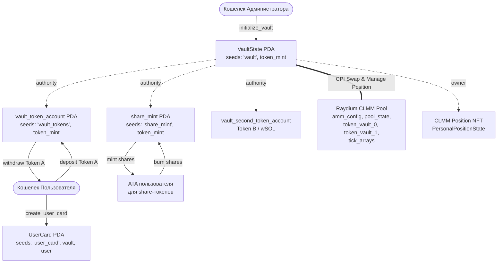

# Сквозной проект «Liquidity Vault» (Недели 8–13)

**Студент:** Илья Коваленко  
**Стек:** Solana, Rust, Anchor Framework (0.31.1), SPL Token / Token-2022, Raydium CLMM CPI, TypeScript (`@solana/web3.js`, `@coral-xyz/anchor`, `@raydium-io/raydium-sdk-v2`)  
**Кластер:** Solana Devnet (Helius RPC)  

---

## 📌 Оглавление

1. [Обзор проекта](#обзор-проекта)
2. [Архитектура и граф аккаунтов (PDA)](#архитектура-и-граф-аккаунтов-pda)
3. [Структура репозитория](#структура-репозитория)
4. [Подробное описание недель (8–13)](#подробное-описание-недель-813)
   - [Неделя 8: Каркас Vault (Инициализация, Seeds, Bumps, Пространство)](#неделя-8-каркас-vault)
   - [Неделя 9: Депозит и выпуск share-токенов (Математика пула)](#неделя-9-депозит-и-выпуск-share-токенов)
   - [Неделя 10: CPI и вывод средств (Сжигание долей, расчет пропорций)](#неделя-10-cpi-и-вывод-средств)
   - [Неделя 11: AMM и Концентрированная ликвидность (Raydium CLMM, Тики)](#неделя-11-amm-и-концентрированная-ликвидность)
   - [Неделя 12: Интеграция с DEX: Swap через Raydium CLMM (Slippage protection)](#неделя-12-интеграция-с-dex-swap-через-raydium-clmm)
   - [Неделя 13: Управление позицией ликвидности (Open, Fee harvest, Close)](#неделя-13-управление-позицией-ликвидности)
5. [Ответы на контрольные вопросы («Проверьте себя» 8–13)](#ответы-на-контрольные-вопросы)
6. [Инструкция по сборке, тестированию и запуску скриптов](#инструкция-по-сборке-тестированию-и-запуску-скриптов)

---

## 🏛 Обзор проекта

**Liquidity Vault** — это децентрализованный инвестиционный смарт-контракт (хранилище ликвидности) на блокчейне Solana.

Хранилище аккумулирует пользовательские депозиты в основном токене (`Token A`), выпускает пользователям ликвидные квитанции долей (`share-токены` стандарта SPL Token), и использует совокупную ликвидность для генерации доходности через предоставление концентрированной ликвидности в пулах **Raydium CLMM (Concentrated Liquidity Market Maker)** и арбитражные/ребалансировочные свопы.

Вся доходность от торговых комиссий в пуле накапливается внутри хранилища, увеличивая обеспечение каждой выпущенной доли. При выводе средств пользователь сжигает свои share-токены и получает назад первоначальный депозит плюс заработанный yield пропорционально своей доле в пуле.

---

## 🧬 Архитектура и граф аккаунтов (PDA)

Все критические компоненты системы контролируются **Program Derived Addresses (PDA)**, у которых нет приватных ключей — подпись транзакций от их имени выполняется непосредственно смарт-контрактом через механизм `invoke_signed`.



### Сиды и спецификация PDA

| Аккаунт | Сиды (Seeds) | Размер (байт) | Назначение |
| :--- | :--- | :---: | :--- |
| **`VaultState`** | `[b"vault", token_mint.key()]` | **153** | Хранит глобальное состояние: `admin`, `token_mint`, `vault_token_account`, `share_mint`, `total_tokens`, `total_shares`, `bump`. |
| **`vault_token_account`** | `[b"vault_tokens", token_mint.key()]` | **165** | SPL Token Account — физическое хранилище токенов Token A. Authority: `vault_state` PDA. |
| **`share_mint`** | `[b"share_mint", token_mint.key()]` | **82** | SPL Mint аккаунт долей хранилища (decimals = 6). Authority: `vault_state` PDA. |
| **`UserCard`** | `[b"user_card", vault.key(), user.key()]` | **89** | Персональная карточка пользователя: `vault`, `owner`, `deposited`, `shares`, `bump`. |

---

## 📂 Структура репозитория

```
solana_clmm_vault/
├── Anchor.toml                                # Конфигурация Anchor и сети Devnet
├── Cargo.toml                                 # Воркспейс манифест Rust
├── package.json                               # Зависимости TypeScript и NPM-скрипты
├── tsconfig.json                              # Настройки компилятора TypeScript
├── programs/
│   └── solana_clmm_vault/
│       ├── Cargo.toml                         # Манифест контракта (anchor-lang, raydium-clmm-cpi)
│       └── src/
│           ├── lib.rs                         # Точка входа программы, макрос #[program], unit-тесты
│           ├── errors.rs                      # Типизированные ошибки (VaultError)
│           ├── state/                         # Состояния ончейн-аккаунтов
│           │   ├── mod.rs
│           │   ├── vault_state.rs             # VaultState структура и LEN
│           │   └── user_card.rs               # UserCard структура и LEN
│           └── instructions/                  # Обработчики инструкций
│               ├── mod.rs
│               ├── initialize_vault.rs        # Неделя 8: Создание хранилища
│               ├── create_user_card.rs        # Неделя 8: Создание карточки пользователя
│               ├── deposit.rs                 # Неделя 9: Депозит токенов и минт долей
│               ├── withdraw.rs                # Неделя 10: Сжигание долей и вывод токенов
│               ├── swap_raydium.rs            # Неделя 12: Своп через Raydium CLMM
│               ├── open_raydium_position.rs   # Неделя 13: Открытие позиции ликвидности
│               └── close_raydium_position.rs  # Неделя 13: Сбор комиссий и закрытие позиции
├── scripts/                                   # Исполняемые скрипты для Devnet
│   ├── week8_init.ts                          # Инициализация Vault и UserCard
│   ├── week9_deposit.ts                       # Депозит токенов и выпуск shares
│   ├── week10_withdraw.ts                     # Вывод средств и сжигание shares
│   ├── week11_create_tokens_and_pool.ts       # Создание Token A, Token B и CLMM пула
│   ├── week12_swap.ts                         # Выполнение свопа с защитой от проскальзывания
│   └── week13_position_management.ts          # Открытие, сбор комиссий и закрытие позиции
└── tests/
    └── vault.ts                               # E2E тесты (Mocha + Chai)
```

---

## 📖 Подробное описание недель (8–13)

### Неделя 8: Каркас Vault
- **Цель:** спроектировать фундамент смарт-контракта, создать структуры данных и настроить детерминированные PDA для безопасного хранения токенов и долей.
- **Инструкции:**
  - `initialize_vault`: создает аккаунт `VaultState`, системный токен-аккаунт хранилища `vault_token_account` и минт квитанций долей `share_mint`. Все три аккаунта выводятся детерминированно из адреса базового токена (`token_mint`).
  - `create_user_card`: создает индивидуальный аккаунт `UserCard` для каждого пользователя. Адрес привязан к паре `(vault_state, user_wallet)`, что исключает подделку чужой позиции и коллизии между пулами.
- **Безопасность:**
  - Проверка канонического `bump`.
  - Точный расчет байт для аренды (`rent exemption`): `VaultState::LEN = 153`, `UserCard::LEN = 89`.
  - Authority токен-аккаунта и минта передается исключительно `vault_state` PDA.

### Неделя 9: Депозит и выпуск share-токенов
- **Цель:** реализовать математику долевого владения пулом, перевод токенов пользователя в хранилище и выпуск share-токенов через CPI.
- **Инструкция:** `deposit(amount: u64)`
- **Математика расчета долей:**
  - **Первый депозит ($S_{total} = 0$ или $T_{total} = 0$):**
    $$S_{mint} = A_{in}$$
    Первый вкладчик получает доли в соотношении 1:1.
  - **Последующие депозиты:**
    $$S_{mint} = \left\lfloor \frac{A_{in} \cdot S_{total}}{T_{total}} \right\rfloor$$
    где $A_{in}$ — вносимое количество токенов, $S_{total}$ — общее количество существующих долей (`total_shares`), $T_{total}$ — общее количество токенов в хранилище (`total_tokens`).
- **CPI-вызовы:**
  1. `anchor_spl::token::transfer`: переводит `amount` с пользовательского токен-аккаунта на `vault_token_account`. Подписывает сам пользователь (`Signer`).
  2. `anchor_spl::token::mint_to`: минтит рассчитанное количество `shares_to_mint` на пользовательский ATA share-токенов. Подписывает `vault_state` PDA через `CpiContext::new_with_signer`.
- **Защита от атак:**
  - Проверка `amount > 0` (`VaultError::ZeroAmount`).
  - Проверка `shares_to_mint > 0` (`VaultError::SharesTooSmall`) — предотвращает бесплатный взнос из-за округления вниз.
  - Безопасная арифметика: `checked_mul` и `checked_div` с кастом к `u128` во избежание переполнения 64-битных целых чисел.

### Неделя 10: CPI и вывод средств
- **Цель:** реализовать обратный процесс — сжигание квитанций долей и пропорциональную выплату токенов из хранилища с учетом накопленной прибыли (yield).
- **Инструкция:** `withdraw(shares_amount: u64)`
- **Математика расчета вывода:**
  $$A_{out} = \left\lfloor \frac{S_{burned} \cdot T_{total}}{S_{total}} \right\rfloor$$
- **Логика доходности:**
  Если в хранилище поступили комиссии (например, $T_{total} = 1\,200\,000$, а $S_{total} = 1\,000\,000$), цена одной доли выросла до 1.2 токена. При сжигании $500\,000$ долей пользователь получает $600\,000$ токенов!
- **CPI-вызовы:**
  1. `anchor_spl::token::burn`: сжигает `shares_amount` с пользовательского ATA долей. Подписывает пользователь (`Signer`).
  2. `anchor_spl::token::transfer`: переводит $A_{out}$ токенов с `vault_token_account` на кошелек пользователя. Подписывает программа от имени `vault_state` PDA.
- **Проверки:**
  - `shares_amount > 0` (`VaultError::ZeroAmount`).
  - `user_card.shares >= shares_amount` (`VaultError::InsufficientShares`).
  - $A_{out} > 0$ (`VaultError::WithdrawTooSmall`).
  - Соблюдение паттерна **Checks-Effects-Interactions**: внутреннее состояние (`total_tokens`, `total_shares`, `user_card.shares`) обновляется *до* внешнего вызова перевода средств.

### Неделя 11: AMM и Концентрированная ликвидность (Raydium CLMM)
- **Цель:** изучить архитектуру AMM третьего поколения (Concentrated Liquidity), создать тестовые токены и инициализировать пул на Devnet.
- **Концепция Concentrated Liquidity:**
  - В классических AMM ($x \cdot y = k$) капитал распределен по всему диапазону цен от $0$ до $\infty$. Реально используется менее 1% внесенной ликвидности.
  - В Raydium CLMM (аналог Uniswap v3 на Solana) ликвидность концентрируется в выбранном диапазоне цен $[P_{lower}, P_{upper}]$. Это повышает капиталоэффективность в $50\text{--}4000\times$, снижает проскальзывание для трейдеров и генерирует больше комиссий на каждый доллар депозита.
- **Тиковая система (Ticks & TickArrays):**
  - Цена привязана к дискретным тикам: $P(i) = 1.0001^i$.
  - На Solana данные тиков сгруппированы в аккаунты фиксированного размера `TickArrayState` (по 60 тиков на массив), чтобы укладываться в лимиты транзакций и памяти рантайма Solana.
- **Скрипт `scripts/week11_create_tokens_and_pool.ts`:**
  - Создает `Token A` и `Token B` (wSOL).
  - Инициализирует пул Raydium CLMM с параметрами конфигурации комиссии (amm_config).
  - Инициализирует необходимые массивы тиков вокруг текущей цены.

### Неделя 12: Интеграция с DEX: Swap через Raydium CLMM
- **Цель:** реализовать CPI-своп активов хранилища через Raydium CLMM с жестким контролем проскальзывания (`slippage protection`).
- **Инструкция:** `swap_raydium(amount_in: u64, min_amount_out: u64)`
- **Механизм защиты от проскальзывания:**
  - Децентрализованные пулы подвержены волатильности и атакам типа Front-running / Sandwich attacks (MEV-боты).
  - Смарт-контракт замеряет баланс второго токена до и после исполнения CPI-свопа:
    $$\Delta = Balance_{after} - Balance_{before}$$
  - Если $\Delta < min\_amount\_out$, транзакция гарантированно откатывается с ошибкой `VaultError::SlippageExceeded`.
- **Авторизация:**
  - Операции обмена активами пула разрешены только администратору (`vault_state.admin == admin.key()`).

### Неделя 13: Управление позицией ликвидности (CLMM Lifecycle)
- **Цель:** реализовать полный жизненный цикл позиции концентрированной ликвидности: открытие позиции от имени хранилища, сбор заработанных комиссий и закрытие позиции.
- **Инструкции:**
  - `open_raydium_position`:
    - Принимает диапазон тиков `[tick_lower_index, tick_upper_index]`, максимальные объемы токенов `amount_0_max`, `amount_1_max` и объем ликвидности `liquidity`.
    - Вызывает CPI в программу Raydium CLMM (`open_position_v2` / `increase_liquidity_v2`).
    - Создается NFT позиции (`PersonalPositionState`), владельцем которой назначается `vault_state` PDA. Это гарантирует, что средства хранилища не могут быть украдены администратором на личный кошелек.
  - `close_raydium_position`:
    - Снимает ликвидность (`decrease_liquidity_v2`), собирает все накопленные swap-комиссии в токенах 0 и 1, переводит токены обратно на счета хранилища и сжигает NFT позиции (`close_position`).
    - Баланс `vault_token_account` пополняется заработанным yield, что автоматически увеличивает ценность долей всех вкладчиков!

---

## ❓ Ответы на контрольные вопросы

### Неделя 8: Каркас Vault
1. **Зачем минт share-токенов делать PDA под управлением программы, а не обычным keypair?**
   > *Ответ:* Если минт управляется обычным keypair, существует закрытый ключ, владелец которого может в любой момент выпустить неограниченное количество share-токенов и украсть все обеспечение из хранилища. Делая authority минта PDA под управлением смарт-контракта (`vault_state`), мы гарантируем, что новые доли могут чеканиться исключительно по жестким ончейн-правилам программы (при реальном поступлении депозита в инструкции `deposit`).

2. **Что произойдет, если передать чужой `token_mint` при вызове `initialize_vault`?**
   > *Ответ:* Адрес `VaultState` формируется сидами `[b"vault", token_mint.key()]`. Если передать чужой токен, будет создано совершенно отдельное, независимое хранилище для этого чужого токена. Базовое хранилище никак не пострадает, так как его PDA защищен уникальностью сида.

3. **Почему размер `UserCard` фиксирован, а не расширяется при каждом депозите?**
   > *Ответ:* Хранение истории транзакций внутри ончейн-аккаунта неэффективно: динамическое расширение аккаунта (`realloc`) требует дополнительных вычислительных единиц (Compute Units), постоянной доплаты за аренду (rent exemption) и ограничено максимальным размером аккаунта на Solana (10 МБ). Вместо хранения массива депозитов `UserCard` агрегирует состояние: накапливает общую сумму `deposited` и текущий баланс `shares`. Полная история транзакций доступна через логи транзакций блокчейна вне чейна.

---

### Неделя 9: Депозит и выпуск share-токенов
1. **Почему для `mint_to` требуются signer seeds, а для `transfer` со счёта пользователя — нет?**
   > *Ответ:* При переводе токенов со счета пользователя транзакцию подписывает сам пользователь своим приватным ключом (он является `Signer` в контексте инструкции). При вызове `mint_to` полномочиями (mint authority) обладает PDA программы (`vault_state`). У PDA нет приватного ключа, поэтому рантайм Solana требует подтверждения полномочий через передачу сидов и bump в `invoke_signed`.

2. **Что произойдёт, если пользователь внесёт слишком мало токенов, так что `shares = 0` из-за целочисленного деления?**
   > *Ответ:* В контракте установлена обязательная проверка `require!(shares_to_mint > 0, VaultError::SharesTooSmall)`. Транзакция будет немедленно прервана с ошибкой, защищая пользователя от потери токенов без начисления акций.

3. **Как изменится стоимость одной доли, если кто-то напрямую отправит токены на адрес хранилища в обход инструкции `deposit`?**
   > *Ответ:* Прямой перевод токенов (donation) увеличит физический баланс `vault_token_account`. Так как количество выпущенных долей $S_{total}$ останется прежним, соотношение $\frac{T_{total}}{S_{total}}$ вырастет — каждая существующая доля станет дороже, принеся нежданную прибыль всем текущим держателям shares.

---

### Неделя 10: CPI и вывод средств
1. **В каком порядке следует выполнять `burn` и `transfer` при выводе и почему?**
   > *Ответ:* Сначала выполняется сжигание долей (`burn`), а затем — перевод токенов (`transfer`). Это соответствует золотому стандарту безопасности **Checks-Effects-Interactions**: сначала списываются права требования (сжигаются акции), и только после этого выдаются базовые активы. Это полностью исключает атаки повторного входа (reentrancy) и двойного списания.

2. **Что произойдёт, если все пользователи одновременно выведут все свои средства?**
   > *Ответ:* Каждый пользователь пропорционально получит свою долю токенов. При выводе последней доли $S_{total}$ станет равен 0, а баланс $T_{total}$ хранилища обнулится. Хранилище вернется в исходное состояние пустого пула, готового принять новый "первый" депозит по курсу 1:1.

3. **Почему проверка `constraint = user_card.owner == user.key()` критически важна?**
   > *Ответ:* Без этой проверки злоумышленник мог бы передать адрес чужой `UserCard` в инструкцию `withdraw` и вывести базовые токены за счет чужих долей, украдя чужие средства. Ограничение Anchor гарантирует, что списывать доли можно только с аккаунта, принадлежащего подписанту транзакции.

---

### Неделя 11: AMM и Концентрированная ликвидность
1. **В чём преимущество концентрированной ликвидности перед классической моделью $x \cdot y = k$?**
   > *Ответ:* В классической модели 99% капитала не участвует в сделках, находясь далеко от рыночной цены. Концентрированная ликвидность позволяет сфокусировать 100% средств в узком коридоре вокруг текущей цены. В результате при том же объеме капитала проскальзывание для трейдеров уменьшается в сотни раз, а поставщики ликвидности зарабатывают в десятки раз больше комиссий на каждый вложенный доллар.

2. **Что происходит с позицией ликвидности, когда рыночная цена выходит за пределы $[P_{lower}, P_{upper}]$?**
   > *Ответ:* Позиция на 100% конвертируется в один наименее ценный актив (если цена упала ниже $P_{lower}$ — вся позиция становится токеном A; если поднялась выше $P_{upper}$ — токеном B) и временно перестает зарабатывать торговые комиссии, пока цена не вернется в диапазон.

3. **Зачем в Raydium CLMM на Solana используются TickArray, а не единая динамическая структура данных?**
   > *Ответ:* В Solana транзакция должна заранее декларировать все читаемые и изменяемые аккаунты. Кроме того, аккаунты имеют лимиты размера и затрат на сериализацию. Разбиение тиков на фиксированные массивы `TickArray` позволяет загружать в транзакцию только те тики, которые реально пересекает своп, минимизируя комиссии и Compute Units.

---

### Неделя 12: Интеграция с DEX: Swap через Raydium CLMM
1. **Чем чреват вызов `swap` без параметра `min_amount_out`?**
   > *Ответ:* Вызов свопа без лимита проскальзывания открывает дверь для **Sandwich-атак (MEV)**: поисковый бот видит транзакцию в мемпуле, ставит перед ней покупку (задирая цену), наша транзакция покупает актив по катастрофически невыгодной цене, а бот сразу после нас продает актив, забирая разницу себе. Параметр `min_amount_out` гарантирует отмену сделки, если цена отклонилась выше допустимого процента.

2. **Как рассчитывается допустимое проскальзывание в процентах?**
   > *Ответ:* Если ожидаемый выход составляет $E_{out}$, а допустимый slippage равен $s$ (например, 1%), то:
   $$min\_amount\_out = E_{out} \cdot (1 - \frac{s}{100})$$
   Для $s = 0.5\%$ при $E_{out} = 1\,000\,000$ получаем $min\_amount\_out = 995\,000$.

3. **Почему аккаунты для Raydium CLMM CPI должны передаваться через полный контекст аккаунтов?**
   > *Ответ:* Для расчета свопа CLMM-рантайму требуются не только токен-аккаунты, но и глобальный стейт пула (`PoolState`), аккаунт конфигурации (`AmmConfig`), оракул наблюдений (`ObservationState`) и актуальные `TickArray`, содержащие данные о ликвидности в зоне текущей цены.

---

### Неделя 13: Управление позицией ликвидности
1. **Кто является владельцем NFT позиции CLMM и почему?**
   > *Ответ:* Владельцем NFT позиции является исключительно `vault_state` PDA. Это гарантирует децентрализацию и сохранность средств вкладчиков: администратор хранилища не может перевести позицию на свой личный кошелек или присвоить активы себе.

2. **Как собранные торговые комиссии из пула попадают вкладчикам хранилища?**
   > *Ответ:* При вызове `close_raydium_position` или harvest комиссии зачисляются на `vault_token_account`. При этом общее количество share-токенов $S_{total}$ не увеличивается. Соответственно, ценность каждой доли возрастает. При вызове `withdraw` любой пользователь автоматически забирает свою долю накопленных комиссий.

3. **Что такое непостоянные потери (Impermanent Loss) и как выбор диапазона тиков влияет на риск IL?**
   > *Ответ:* Непостоянные потери — это разница в стоимости портфеля между предоставлением ликвидности в пул и простым удержанием (HODL) активов на кошельке, возникающая из-за изменения соотношения цен активов. Чем уже выбранный диапазон тиков, тем выше капиталоэффективность и доход от комиссий, но тем быстрее и агрессивнее растут непостоянные потери при сильном трендовом движении цены.

---

## 🚀 Инструкция по сборке, тестированию и запуску скриптов

### 1. Предварительные требования
- Rust 1.75+ (в проекте протестировано на `1.98.1 x86_64-pc-windows-gnu`)
- Solana CLI 1.18+ (`solana --version`)
- Node.js 18+ и `npm`

### 2. Сборка и запуск unit-тестов смарт-контракта (Rust)
Для сборки с учетом пути рабочего каталога на Windows:
```powershell
$env:CARGO_TARGET_DIR="C:\temp\cargo_target"
cd solana_clmm_vault
cargo test
```
*Результат: все 6 модульных тестов успешно проходят (`6 passed; 0 failed`).*

### 3. Установка зависимостей TypeScript
```powershell
cd solana_clmm_vault
npm install
```

### 4. Запуск E2E тестов в Anchor / Localnet / Devnet
```powershell
npm test
```

### 5. Пошаговый запуск скриптов на Solana Devnet (Недели 8–13)

1. **Неделя 8 — Инициализация Vault и UserCard:**
   ```powershell
   npm run init-vault
   ```
2. **Неделя 9 — Депозит токенов и выпуск shares:**
   ```powershell
   npm run deposit
   ```
3. **Неделя 10 — Вывод средств и сжигание shares:**
   ```powershell
   npm run withdraw
   ```
4. **Неделя 11 — Создание тестовых токенов и пула Raydium CLMM:**
   ```powershell
   npm run create-pool
   ```
5. **Неделя 12 — Исполнение свопа с защитой от проскальзывания:**
   ```powershell
   npm run swap
   ```
6. **Неделя 13 — Управление позицией ликвидности (Open, Fee harvest, Close):**
   ```powershell
   npm run position
   ```
