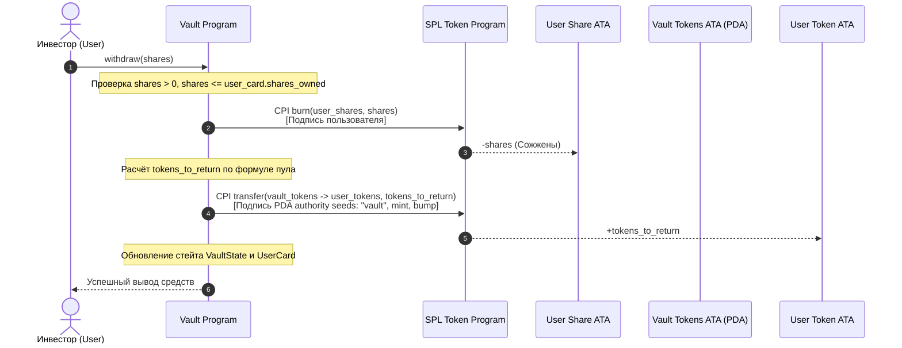

# Неделя 10: CPI и вывод средств (withdraw)

Программа хранилища (**Liquidity Vault**) — механизм вывода средств через **Cross-Program Invocation (CPI)** в SPL Token Program с PDA-подписью (`invoke_signed`), сжигание share-токенов и возврат базовых активов.

---

## Задание

1. Реализовать инструкцию `withdraw`:
   - Принять от инвестора количество сжигаемых share-токенов `shares: u64`.
   - Проверить, что пользователь владеет достаточным количеством акций и карточка `UserCard` принадлежит ему.
   - Сжечь share-токены на аккаунте пользователя через CPI `token::burn`.
   - Рассчитать причитающееся количество токенов по текущей стоимости пула:
     $$\text{TokensReturned} = \left\lfloor \frac{\text{SharesBurned} \cdot \text{TotalTokens}}{\text{TotalShares}} \right\rfloor$$
     где `tokens_to_return = floor(shares * total_vault_tokens / total_shares)`.
   - Вывести средства из `vault_tokens` на личный токен-аккаунт инвестора через CPI `token::transfer` с использованием сидов и бампа хранилища (`seeds: [b"vault", token_mint.as_ref(), &[bump]]`).
   - Уменьшить счётчики `total_vault_tokens` и `total_shares` в `VaultState`, а также `shares_owned` в `UserCard`.
2. Создать скрипт автоматизированного вывода в devnet (`scripts/week10_withdraw.ts`).

---

## Как устроена инструкция withdraw



---

## Какие CPI-вызовы выполняются в транзакции

Транзакция объединяет два атомарных вызова в SPL Token Program:

1. **CPI Token Burn**:
   - Инструкция: `token::burn`
   - Подписант: Инвестор (User)
   - Действие: Уничтожает `shares` токенов на `user_share_account`, уменьшая общее предложение (`supply`) минта `share_mint`.
2. **CPI Token Transfer with PDA Signer**:
   - Инструкция: `token::transfer`
   - Подписант: PDA аккаунт `vault_state`
   - Сиды: `&[b"vault".as_ref(), token_mint.as_ref(), &[vault_bump]]`
   - Действие: Переводит рассчитанные токены из защищенного хранилища `vault_tokens` на личный кошелек пользователя.

```rust
// Передача токенов из vault пользователю с PDA-подписью:
let seeds = &[
    b"vault".as_ref(),
    ctx.accounts.token_mint.to_account_info().key.as_ref(),
    &[ctx.accounts.vault_state.bump],
];
let signer = &[&seeds[..]];

let cpi_accounts = Transfer {
    from: ctx.accounts.vault_tokens.to_account_info(),
    to: ctx.accounts.user_token_account.to_account_info(),
    authority: ctx.accounts.vault_state.to_account_info(),
};
let cpi_ctx = CpiContext::new_with_signer(
    ctx.accounts.token_program.to_account_info(),
    cpi_accounts,
    signer,
);
token::transfer(cpi_ctx, tokens_to_return)?;
```

---

## Аккаунты инструкции `withdraw`

| Аккаунт | Тип | Описание |
| :--- | :--- | :--- |
| `vault_state` | `mut, seeds = [b"vault", token_mint.key().as_ref()]` | Главный стейт пула, выступающий PDA-подписантом для `vault_tokens` |
| `vault_tokens` | `mut, seeds = [b"vault_tokens", token_mint.key().as_ref()]` | Источник базовых токенов хранилища |
| `share_mint` | `mut, seeds = [b"share_mint", token_mint.key().as_ref()]` | Минт share-токенов (сжигание уменьшает supply) |
| `user_card` | `mut, seeds = [b"user_card", vault_state.key().as_ref(), user.key().as_ref()]` | Карточка пользователя для списания `shares_owned` |
| `user_share_account`| `mut` | ATA пользователя, откуда сжигаются акции |
| `user_token_account`| `mut` | ATA пользователя, куда возвращаются базовые токены |
| `user` | `mut, signer` | Владелец средств и карточки |
| `token_program` | `Program<'info, Token>` | Программа SPL Token |

---

## Запуск и проверка

```bash
# Запуск юнит-тестов
cargo test

# Запуск скрипта вывода в Devnet
npx ts-node scripts/week10_withdraw.ts
```

---

## Проверьте себя

1. **Почему `token::burn` не требует `new_with_signer` от программы?**
   > *Ответ:* Сжигание происходит с токен-аккаунта самого пользователя (`user_share_account`). Владельцем (authority) этого аккаунта является сам пользователь, поэтому инструкцию `burn` подписывает пользователь своей транзакционной подписью (`ctx.accounts.user`).
2. **Как рассчитывается вывод, если хранилище получило прибыль или убыток?**
   > *Ответ:* Расчёт строго пропорционален: $\text{tokens} = \frac{\text{Shares} \cdot \text{TotalTokens}}{\text{TotalShares}}$. Если в пуле стало больше токенов за счёт комиссий swap, каждая акция приносит больше базовых токенов, чем при депозите.
3. **Что предотвращает несанкционированный вывод токенов злоумышленником?**
   > *Ответ:* Проверки констрейнтов Anchor (`seeds` и `bump`), проверка владения карточкой (`user_card.owner == user.key()`), а также обязательное наличие и сжигание реальных share-токенов на счёте вызывающего.
4. **Что происходит при частичном выводе (partial withdraw)?**
   > *Ответ:* Сжигается ровно переданное количество акций `shares`. Оставшаяся часть сохраняется в `user_card.shares_owned` и на балансе `user_share_account`, продолжая участвовать в распределении доходности пула.
