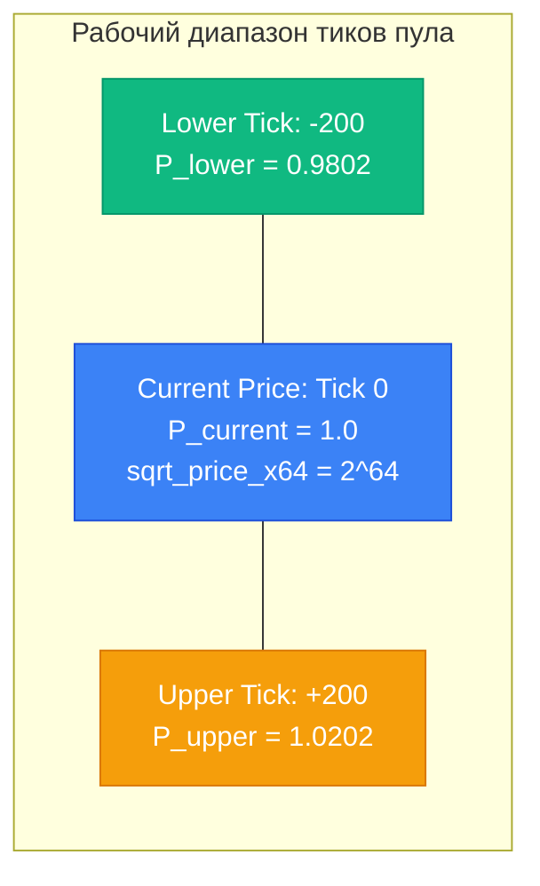
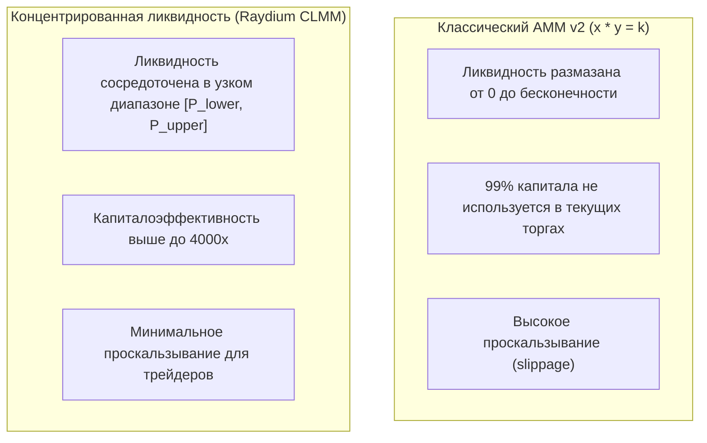

# Неделя 11: AMM и концентрированная ликвидность (Raydium CLMM)

Создание пула ликвидности нового поколения на **Solana Devnet** через **Raydium Concentrated Liquidity Market Maker (CLMM)**, минтинг тестовых SPL-токенов, математика тиков и расчёт `sqrt_price_x64`.

---

## Задание

1. Выпустить два тестовых SPL-токена в сети Solana Devnet:
   - **Token A (Base)**: `6 decimals`
   - **Token B (Quote)**: `6 decimals`
2. Рассчитать параметры начальной цены:
   - Начальное соотношение: $1 \text{ Token A} = 1 \text{ Token B}$ (Цена $P = 1.0$).
   - Вычислить значение квадратного корня цены в формате с фиксированной точкой: $\text{sqrt\_price\_x64} = 2^{64} \approx 18446744073709551616$.
   - Определить рабочий диапазон тиков с шагом `tick_spacing = 10` (например, от `tick_lower = -200` до `tick_upper = 200`).
3. Разработать скрипт создания пула (`scripts/week11_create_tokens_and_pool.ts`) с использованием Raydium SDK и Solana Web3.js.
4. Зафиксировать адреса созданного пула и токенов в конфигурации проекта.

---

## Адреса и параметры пула (Devnet)

| Параметр / Аккаунт | Адрес / Значение | Назначение |
| :--- | :--- | :--- |
| **CLMM Program ID** | `devi51mZmdwUJGU9hjN27vEz64Gps7uUefqxg27EAtH` | Официальный смарт-контракт Raydium CLMM в сети Devnet |
| **Token A (Base Mint)** | Сгенерированный SPL Mint | Базовый токен пула |
| **Token B (Quote Mint)** | Сгенерированный SPL Mint | Котируемый токен пула |
| **Fee Tier / Config** | `0.05%` (Amm Config 0) | Уровень торговой комиссии пула |
| **Tick Spacing** | `10` | Допустимый шаг дискретизации ценовых уровней |
| **Диапазон тиков** | `[-200, +200]` | Диапазон концентрированной ликвидности |
| **Начальная цена P** | `1.0` | 1 Token A = 1 Token B |
| **sqrt_price_x64** | `18446744073709551616` | $\lfloor \sqrt{1.0} \times 2^{64} \rfloor$ |

---

## Цена и диапазон тиков (Tick Math)

В архитектуре Concentrated Liquidity (Uniswap v3 / Raydium CLMM) непрерывный ценовой график разбивается на дискретные тики (ticks):

$$P(i) = 1.0001^i$$

Где $i$ — целочисленный индекс тика (`i32`).

### Переход к $\sqrt{P}$ и формату `Q64.64`
Для эффективных вычислений на блокчейне без потери точности и работы с дробями используется квадратный корень цены, умноженный на $2^{64}$:

$$\sqrt{P(i)} = 1.0001^{i / 2}$$
$$\text{sqrt\_price\_x64} = \left\lfloor \sqrt{P} \times 2^{64} \right\rfloor$$



---

## CLMM vs Классический AMM v2 ($x \cdot y = k$)



---

## Запуск скрипта создания пула

```bash
# Установка зависимостей
yarn install

# Запуск создания токенов и пула в Devnet
npx ts-node scripts/week11_create_tokens_and_pool.ts
```

Скрипт выполняет:
1. Создание минтов Token A и Token B на кошелек разработчика.
2. Сортировку адресов токенов (`token_0 < token_1`), требуемую CLMM контрактом.
3. Расчёт `sqrt_price_x64` и формирование транзакции инициализации пула.

---

## Проверьте себя

1. **Что такое `tick_spacing` и почему индексы тиков должны быть ему кратны?**
   > *Ответ:* `tick_spacing` — это минимальный шаг между ценовыми границами ордеров в пуле (зависит от комиссии: чем ниже комиссия, тем мельче шаг). Кратность тиков (`tick % tick_spacing == 0`) необходима для экономии памяти в аккаунтах `TickArrayBitmap` и оптимизации поиска следующего инициализированного тика при свапе.
2. **Что означает формат цены `sqrt_price_x64`?**
   > *Ответ:* Это число с фиксированной точкой (fixed-point Q64.64), где целая часть занимает 64 бита, а дробная масштабирована на $2^{64}$. Квадратный корень используется потому, что в формулах концентрированной ликвидности дельта токенов $\Delta x$ и $\Delta y$ линейно зависит от $\Delta \sqrt{P}$.
3. **Что происходит с позицией ликвидности, когда рыночная цена выходит за пределы диапазона?**
   > *Ответ:* Если цена падает ниже `P_lower`, позиция на 100% конвертируется в более дешевый Token A и перестает генерировать торговые комиссии. Если цена поднимается выше `P_upper`, позиция на 100% переходит в Token B.
4. **Почему адреса токенов в пуле обязаны быть отсортированы (`mint_0 < mint_1`)?**
   > *Ответ:* Канонический порядок токенов гарантирует детерминированность адреса PDA пула и предотвращает создание дублирующих пулов для одной и той же пары валют.
