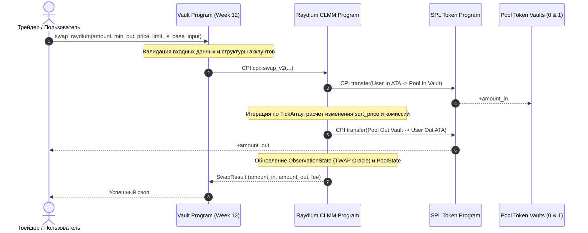

# Неделя 12: Swap через Raydium CLMM

Интеграция со смарт-контрактом **Raydium CLMM** через **Cross-Program Invocation (CPI)**: совершение атомарного обмена токенов внутри концентрированного пула, защита от проскальзывания (`slippage`), ценовые лимиты и обновление оракулов.

---

## Задание

1. Добавить инструкцию `swap_raydium` в смарт-контракт:
   - Интегрировать официальный крейт `raydium-clmm-cpi`.
   - Настроить безопасный CPI-вызов в программу `devi51mZmdwUJGU9hjN27vEz64Gps7uUefqxg27EAtH`.
   - Реализовать валидацию входных параметров:
     - `amount`: сумма входного токена.
     - `other_amount_threshold`: минимальное гарантированное количество выходного токена (slippage protection).
     - `sqrt_price_limit_x64`: ценовой стоп-лимит в формате Q64.64.
     - `is_base_input: bool`: направление обмена (точное количество на входе или на выходе).
2. Написать клиентский скрипт `scripts/week12_swap.ts` для совершения реального свопа в сети Devnet.

---

## Архитектура вызова Swap через CPI



---

## Параметры инструкции `swap_raydium`

| Параметр | Тип | Назначение и логика работы |
| :--- | :--- | :--- |
| `amount` | `u64` | Количество токенов (если `is_base_input = true` — сколько отдаем; если `false` — сколько хотим получить) |
| `other_amount_threshold` | `u64` | Порог проскальзывания. При `is_base_input = true` это `min_amount_out` (минимально допустимая сумма выхода) |
| `sqrt_price_limit_x64` | `u128` | Максимально/минимально допустимая цена исполнения. Защищает от экстремального сдвига цены в неликвидных пулах |
| `is_base_input` | `bool` | `true` — Exact In (точный вход, переменный выход); `false` — Exact Out (переменный вход, точный выход) |

---

## Аккаунты инструкции `swap_raydium`

| Аккаунт | Описание |
| :--- | :--- |
| `payer` | Подписант транзакции (владелец токенов и оплачивающий gas) |
| `clmm_program` | Программа Raydium CLMM (`devi51mZmdwUJGU9hjN27vEz64Gps7uUefqxg27EAtH`) |
| `amm_config` | Аккаунт конфигурации пула с комиссиями и параметрами протокола |
| `pool_state` | Состояние пула: текущий тик, `sqrt_price_x64`, ликвидность $L$ |
| `input_token_account` | ATA плательщика для исходного токена |
| `output_token_account` | ATA плательщика для получаемого токена |
| `input_vault` / `output_vault` | Токен-хранилища самого пула Raydium |
| `observation_state` | Кольцевой буфер ценовых наблюдений для TWAP оракула |
| `remaining_accounts` | `TickArray` аккаунты, содержащие ликвидность на проходимых ценовых интервалах |

---

## Запуск и проверка

```bash
# Запуск тестов
cargo test

# Запуск клиентского скрипта свопа в Devnet
npx ts-node scripts/week12_swap.ts
```

---

## Проверьте себя

1. **Что означает флаг `is_base_input`?**
   > *Ответ:* `is_base_input = true` задает режим "Exact In": пользователь точно указывает, сколько входных токенов он хочет продать (`amount`), а `other_amount_threshold` выступает как нижняя граница (`min_out`). Если `false` ("Exact Out"), `amount` — это желаемая сумма покупки, а `other_amount_threshold` — максимальная сумма входных токенов (`max_in`), которую разрешено списать.
2. **Зачем нужен параметр `sqrt_price_limit_x64`?**
   > *Ответ:* Он предотвращает выполнение сделки при пересечении невыгодной ценовой отметки. Если в стакане ликвидности недостаточно ордеров, цена начнет резко смещаться. Как только цена достигает `sqrt_price_limit_x64`, исполнение сделки останавливается.
3. **Зачем в swap передаются аккаунты `tick_array`?**
   > *Ответ:* В модели CLMM данные о ликвидности разбиты по тикам, сгруппированным в аккаунты `TickArray` (по 60 тиков на массив). Чтобы программа Raydium могла обновить состояние тиков и переместить цену через ценовые уровни, соответствующие `TickArray` должны быть переданы в инструкцию.
4. **Какую роль выполняет `observation_state`?**
   > *Ответ:* Это скользящее окно (аккумулятор) исторических цен и ликвидности пула. При каждом свопе туда записывается новое наблюдение с текущим таймстемпом, позволяя другим протоколам считывать устойчивые средневзвешенные по времени цены (TWAP), защищенные от flash-loan манипуляций.
