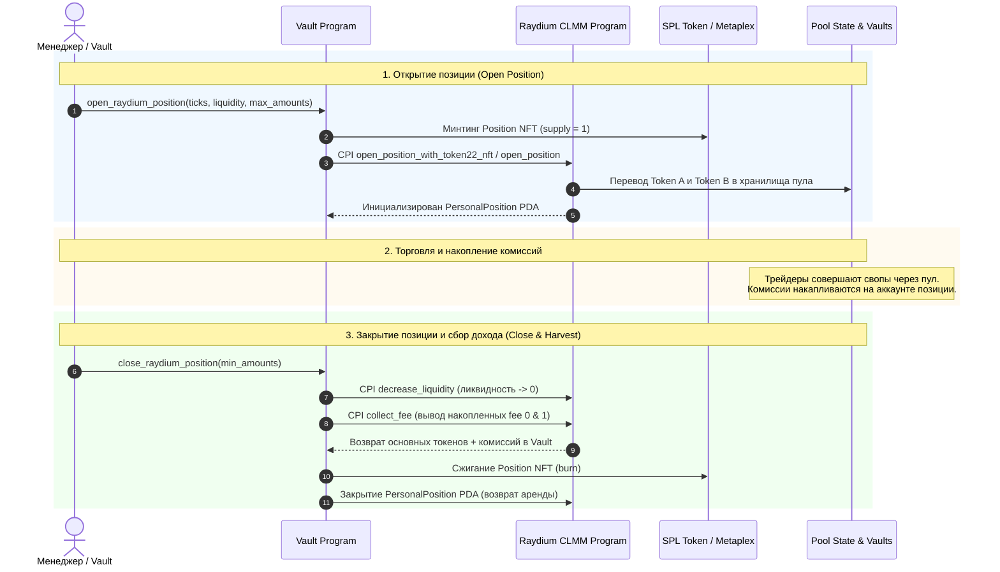

# Неделя 13: Жизненный цикл позиции в Raydium CLMM

Управление концентрированной ликвидностью в **Raydium CLMM**: открытие позиции с минтингом **Position NFT**, сбор накопленных торговых комиссий (**fee harvesting**), возврат активов из пула и анализ непостоянных потерь (**Impermanent Loss**).

---

## Задание

1. Реализовать полный жизненный цикл позиции ликвидности в смарт-контракте:
   - Инструкция `open_raydium_position`:
     - Создание и минтинг уникального NFT позиции.
     - Инициализация аккаунтов `personal_position` и `protocol_position`.
     - Добавление ликвидности в заданный интервал тиков $[i_{lower}, i_{upper}]$.
   - Инструкция `close_raydium_position`:
     - Снятие всей активной ликвидности (decrease liquidity до 0).
     - Сбор накопленных комиссий по обоим токенам пары.
     - Сжигание Position NFT и закрытие токен-счетов.
     - Закрытие аккаунта позиции и возврат rent-exempt депозита.
2. Разработать сценарий автоматизации в devnet (`scripts/week13_position_management.ts`).

---

## Жизненный цикл позиции CLMM



---

## Модель владения позицией через NFT

В отличие от классических AMM, где доля выражается в стандартных fungible LP-токенах, в Concentrated Liquidity каждая позиция уникальна (свой диапазон тиков, размер ликвидности и накопленные комиссии). 

Для обеспечения ликвидности и перемещаемости позиции Raydium чеканит **NFT позиции**:
- **Personal Position PDA**: содержит границы тиков (`tick_lower_index`, `tick_upper_index`), размер ликвидности $L$, маркеры несобранных комиссий `fee_growth_inside_0_last_x64` и `fee_growth_inside_1_last_x64`.
- **Protocol Position PDA**: глобальный счётчик ликвидности протокола на данном диапазоне тиков.
- **Position NFT**: аккаунт, держатель которого обладает эксклюзивным правом изменять ликвидность, забирать комиссии и закрывать позицию.

---

## Математика комиссий и Impermanent Loss (IL)

### 1. Непостоянные потери (Impermanent Loss)
При изменении относительной цены активов в пуле с $P_0$ до $P_1$ (где коэффициент изменения цены $k = \frac{P_1}{P_0}$), потери по сравнению с простым удержанием (HODL) рассчитываются по формуле:

$$IL(k) = \frac{2 \sqrt{k}}{1 + k} - 1$$

| Изменение цены ($k$) | Потери IL (AMM v2) | Потери IL в узком диапазоне CLMM |
| :---: | :---: | :---: |
| **1.25x (+25%)** | `-0.60%` | До `-3.5%` при узком диапазоне |
| **1.50x (+50%)** | `-2.02%` | До `-12.0%` при узком диапазоне |
| **2.00x (+100%)** | `-5.72%` | Полный выход в один токен (100% Token B) |

### 2. Компенсация доходностью от комиссий (Fee Yield)
Концентрированная ликвидность генерирует комиссии со всего торгового объёма, проходящего через диапазон, с мультипликатором капитала до **100x–4000x**:

$$\text{Net Yield} = \sum \text{Collected Fees} - \text{Impermanent Loss}$$

Если объём торгов в пуле высок, накопленные комиссии многократно перекрывают IL.

---

## Аккаунты инструкции `close_raydium_position`

| Аккаунт | Назначение |
| :--- | :--- |
| `nft_owner` | Владелец Position NFT (в нашем случае PDA хранилища `vault_state`) |
| `nft_account` | Токен-аккаунт, хранящий Position NFT |
| `personal_position` | PDA состояния закрываемой позиции Raydium |
| `pool_state` | Состояние пула Raydium CLMM |
| `protocol_position` | Глобальный аккаунт позиции пула |
| `token_vault_0` / `token_vault_1` | Хранилища токенов пула Raydium |
| `recipient_token_account_0` / `1` | Токен-счета Vault, куда возвращаются активы и собранные комиссии |
| `tick_array_lower` / `upper` | Массивы тиков диапазона для деактивации ликвидности |

---

## Запуск и проверка

```bash
# Тестирование математики IL и пространств аккаунтов
cargo test

# Запуск скрипта управления позицией в Devnet
npx ts-node scripts/week13_position_management.ts
```

---

## Проверьте себя

1. **Зачем позиция ликвидности представлена в виде NFT?**
   > *Ответ:* Каждая позиция в CLMM строго индивидуальна: она имеет свой собственный диапазон цен $[P_{lower}, P_{upper}]$, свой объём ликвидности и свой персональный счётчик комиссий. NFT позволяет сделать такую уникальную позицию переносимым финансовым активом, который можно передавать, использовать в качестве залога в DeFi или хранить на мультисиге.
2. **В какой валюте начисляются и собираются комиссии в пуле CLMM?**
   > *Ответ:* Комиссии начисляются непосредственно в исходных токенах пула (Token A и Token B) от каждого прошедшего свапа. При вызове сбора комиссий инвестор получает оба токена пропорционально структуре торгов.
3. **Что происходит с позицией при выходе цены за границы диапазона?**
   > *Ответ:* Позиция на 100% переходит в один из токенов (в менее ценный актив) и временно прекращает зарабатывать торговые комиссии. Как только рыночная цена возвращается в диапазон, позиция автоматически снова становится двусторонней и возобновляет генерацию комиссий.
4. **Что происходит с арендой (rent-exempt SOL) при закрытии позиции?**
   > *Ответ:* После сжигания NFT и уменьшения ликвидности до 0 аккаунт `personal_position` закрывается, и все заблокированные на нём SOL возвращаются инициатору транзакции (`vault_state` / `admin`).
