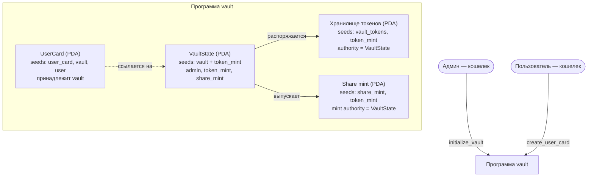

# Неделя 8 — Каркас vault

**Задание:** создать каркас vault для SPL-токена, выпустить `share_mint` и создать карточку пользователя (`UserCard`).

**Код инструкций:** `initialize_vault` и `create_user_card` в [`programs/week8_vault_skeleton/src/lib.rs`](./programs/week8_vault_skeleton/src/lib.rs), клиент — [`scripts/week8_init.ts`](./scripts/week8_init.ts).

---

### Схема аккаунтов

---

### Таблица аккаунтов

| Аккаунт | Seeds | Владелец аккаунта (owner) | Кто распоряжается | Что хранит |
| :--- | :--- | :--- | :--- | :--- |
| **`VaultState`** | `["vault", token_mint]` | Программа vault | Меняет только программа; админ задаёт параметры | `admin`, `token_mint`, адреса хранилища и share mint, `total_tokens`, `total_shares`, `bump` |
| **`vault_token_account`** | `["vault_tokens", token_mint]` | SPL Token Program | Распоряжается PDA `VaultState` (через `invoke_signed`) | Физический баланс токенов Token A в хранилище |
| **`share_mint`** | `["share_mint", token_mint]` | SPL Token Program | Чеканит только PDA `VaultState` при депозите | Минт квитанций долей (SPL Mint, decimals = 6), суммарную эмиссию (`supply`) |
| **`UserCard`** | `["user_card", vault, user]` | Программа vault | Принадлежит пользователю, изменяет программа | Адрес `vault`, кошелек `owner`, `deposited`, `shares`, `bump` |

---

### Как работает

1. **Инициализация хранилища (`initialize_vault`):**
   - Создаются 3 связанных аккаунта: стейт, физический токен-аккаунт и минт долей.
   - Все 3 аккаунта выводятся детерминированно из `token_mint`.
   - Владельцем хранилища и минта становится PDA `vault_state` — у него нет приватного ключа, им управляет только смарт-контракт.
2. **Создание карточки пользователя (`create_user_card`):**
   - У каждого пользователя создается уникальная карточка с сидами `["user_card", vault, user]`.
   - Фиксированный размер в 89 байт избавляет от необходимости динамического расширения (`realloc`) и экономит Compute Units.
   - Инициализируются поля: `deposited = 0`, `shares = 0`.

---

### Проверьте себя

- **Зачем минт share-токенов делать PDA под управлением программы, а не обычным keypair?**  
  Обычный keypair имеет закрытый ключ, владелец которого может тайно допечатать неограниченное количество shares и опустошить хранилище. Минт под управлением PDA гарантирует, что выпуск долей возможен исключительно по коду смарт-контракта в момент внесения реального депозита.

- **Что произойдет, если передать чужой `token_mint` при вызове `initialize_vault`?**  
  Адрес `VaultState` формируется сидами `[b"vault", token_mint.key()]`. Если передать чужой токен, будет создано совершенно отдельное, независимое хранилище для этого токена. Базовое хранилище никак не пострадает, так как его PDA защищен уникальностью сида.

- **Почему размер `UserCard` фиксирован, а не расширяется при каждом депозите?**  
  Хранение массива истории всех депозитов ончейн приводит к постоянному росту платы за аренду (rent exemption), перерасходу лимита Compute Units при чтении/записи и ограничено 10 МБ. Вместо этого `UserCard` хранит агрегированные суммы (`deposited`, `shares`), а детальная история операций доступна через логи транзакций блокчейна.
