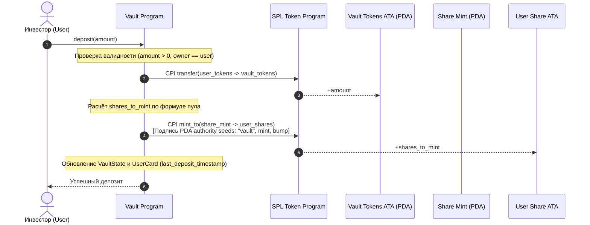

# Неделя 9: Депозит и share-токены

Программа хранилища (**Solana CLMM Vault**) — реализация инструкции `deposit`, пропорциональный минтинг share-токенов через CPI с PDA-подписью, учёт позиций в `UserCard` и `VaultState`.

---

## Задание

1. Добавить инструкцию `deposit` в смарт-контракт хранилища:
   - Принять от пользователя сумму депозита `amount: u64`.
   - Перевести токены пользователя в защищённый vault-аккаунт через CPI в `token::transfer`.
   - Рассчитать количество выпускаемых share-токенов пропорционально доле в общем пуле.
   - Сминтить share-токены на ATA пользователя с PDA-авторизацией (`token::mint_to` через `new_with_signer`).
   - Обновить внутренний стейт хранилища (`total_vault_tokens`, `total_shares`) и карточки инвестора (`deposited_amount`, `shares_owned`, `last_deposit_timestamp`).
2. Разработать клиентский скрипт на TypeScript (`scripts/week9_deposit.ts`) для автоматического тестирования депозита в devnet.

---

## Как устроена инструкция deposit



---

## Математика расчета долей (Shares Formula)

В основе пула ликвидности лежит стандартная пропорциональная модель (ERC-4626 / SPL Vault standard):

### 1. Первый депозит (Initial Deposit)
Когда хранилище пусто (`total_shares == 0` или `total_vault_tokens == 0`):
$$\text{Shares} = \text{Amount}$$
Соотношение задаётся $1:1$ (`shares_to_mint = amount`).

### 2. Последующие депозиты (Subsequent Deposits)
Когда пул уже содержит активы и выпущенные акции:
$$\text{Shares} = \left\lfloor \frac{\text{Amount} \cdot \text{TotalShares}}{\text{TotalTokens}} \right\rfloor$$
где `shares_to_mint = floor(amount * total_shares / total_vault_tokens)`.

Все вычисления производятся с расширением типов до `u128` с обязательным контролем переполнений (`checked_mul`, `checked_div`):
```rust
let shares_to_mint: u64 = if vault.total_shares == 0 || vault.total_vault_tokens == 0 {
    amount
} else {
    (amount as u128)
        .checked_mul(vault.total_shares as u128)
        .ok_or(VaultError::MathOverflow)?
        .checked_div(vault.total_vault_tokens as u128)
        .ok_or(VaultError::MathOverflow)? as u64
};
```

> [!NOTE]
> Если хранилище получает прибыль (например, комиссии от AMM swap), `total_vault_tokens` растёт без выпуска новых акций. В результате цена одной акции $\frac{\text{TotalTokens}}{\text{TotalShares}}$ увеличивается, защищая инвесторов от размытия долей.

---

## Аккаунты инструкции `deposit`

| Аккаунт | Тип / Модификатор | Описание и назначение |
| :--- | :--- | :--- |
| `vault_state` | `mut, seeds = [b"vault", token_mint.key().as_ref()]` | PDA с общим состоянием пула и счётчиками долей |
| `vault_tokens` | `mut, seeds = [b"vault_tokens", token_mint.key().as_ref()]` | Защищённый токен-аккаунт хранилища, куда поступает депозит |
| `share_mint` | `mut, seeds = [b"share_mint", token_mint.key().as_ref()]` | Минт SPL-токенов долей (mint authority = `vault_state`) |
| `user_card` | `mut, seeds = [b"user_card", vault_state.key().as_ref(), user.key().as_ref()]` | Персональная карточка пользователя для учёта позиции |
| `user_token_account` | `mut` | ATA пользователя с исходным токеном, откуда списываются средства |
| `user_share_account` | `mut` | ATA пользователя для зачисления выпущенных share-токенов |
| `user` | `mut, signer` | Инвестор, подписывающий транзакцию и передающий токены |
| `token_program` | `Program<'info, Token>` | SPL Token Program для выполнения transfer и mint_to |

---

## Запуск и проверка

### Запуск unit-тестов
```bash
cargo test
```
Тест валидирует:
- Базовый случай первого депозита $1:1$.
- Пропорциональный депозит с учётом накопленной доходности пула.
- Деривацию всех PDA адресов.

### Запуск клиентского скрипта (Devnet)
```bash
npx ts-node scripts/week9_deposit.ts
```

---

## Проверьте себя

1. **Почему для `mint_to` требуются seeds и bump в `CpiContext::new_with_signer`?**
   > *Ответ:* Mint authority для `share_mint` является PDA аккаунт `vault_state`. У PDA нет приватного ключа. Solana рантайм позволяет PDA подписывать инструкции через механизм Program Derived Address signing, передавая сиды и бамп в рантайм (`invoke_signed`).
2. **Что произойдет, если пользователь попытается внести 0 токенов?**
   > *Ответ:* Сработает кастомная ошибка `VaultError::ZeroDepositAmount` (`require!(amount > 0)`), транзакция откатится без списания комиссий за трансфер.
3. **Как защититься от атаки первого депозита (Inflation / Share Dilution Attack)?**
   > *Ответ:* При первом депозите блокируется минимальное несгораемое количество "мертвых акций" (virtual shares / dead shares, например 1000 единиц), сжигаемых на адресе `11111111111111111111111111111111`, либо используется виртуальный оффсет $s = \frac{a \cdot (S + 1)}{T + 1}$.
4. **В каком порядке должны обновляться балансы в стейте и выполняться CPI?**
   > *Ответ:* По паттерну Checks-Effects-Interactions сначала производятся все проверки входных данных и делений, затем выполняется списание средств пользователя через CPI `transfer`, затем безопасный минтинг через CPI `mint_to`, и фиксируются итоговые изменения в структурах `VaultState` и `UserCard`.
